# Levik Rewards Programme — API plan

This document maps every screen of the Levik Admin web app, and of the plumber and retailer mobile app, to the backend API. For each endpoint it gives the method, path, parameters, request and response objects, and errors. It also shows how the whole system operates end to end.

| | |
| --- | --- |
| **Backend** | Supabase (Postgres 17, Auth, auto-generated REST API, Storage, Edge Functions), Mumbai region |
| **Source of truth** | `supabase/migrations/*.sql`. This document describes those files. |
| **Status keys** | ✅ **Built**: exists in the migrations and is covered by `npm run db:test`. 🟡 **Planned**: needed by a screen but not yet implemented. |

---

## Contents

1. [System overview](#1-system-overview)
2. [How the system operates (flow diagrams)](#2-how-the-system-operates)
3. [API conventions](#3-api-conventions)
4. [Data schema and objects](#4-data-schema-and-objects)
5. [Admin web app: endpoints by page](#5-admin-web-app--endpoints-by-page)
6. [Mobile app: endpoints by screen](#6-mobile-app--endpoints-by-screen)
7. [Storage, Edge Functions and integrations](#7-storage-edge-functions-and-integrations)
8. [Access matrix](#8-access-matrix)
9. [Errors](#9-errors)
10. [Endpoint index](#10-endpoint-index)
11. [Build backlog (planned items)](#11-build-backlog)

---

## 1. System overview

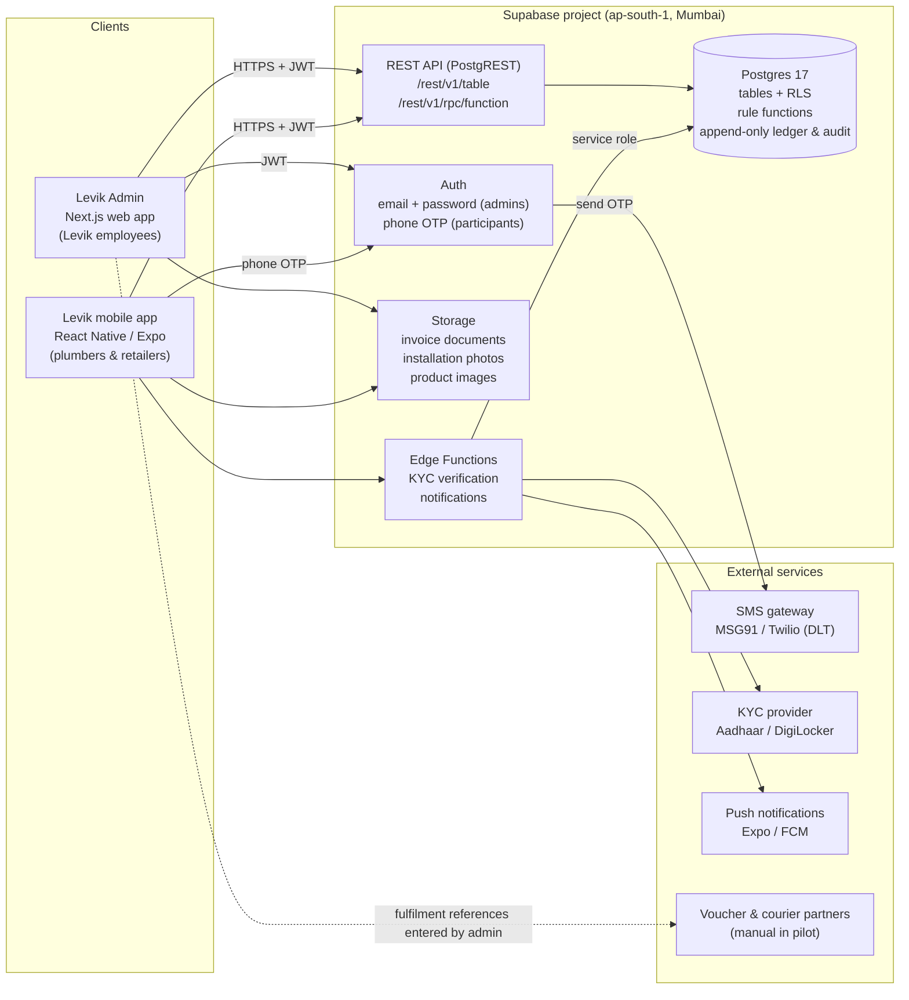

**Design principles**

- **Reads go through the REST API on tables and views.** Row-level security (RLS) filters every row, so participants only ever receive their own records.
- **Every state change goes through a function** called as `POST /rest/v1/rpc/<name>`. A function runs as one database transaction. It locks the rows it touches, re-runs the same checks the reviewer saw, writes points to the ledger, updates stock and scheme awards, and records history and audit entries. Then it commits everything, or nothing.
- **Balances are never stored.** They are always derived from the append-only `points_ledger`.
- **Admins edit catalogue and profile columns directly** (`PATCH` / `POST`). Column-level grants block status, stock and points columns, and a trigger audits every edit.

---

## 2. How the system operates

### 2.1 End-to-end programme flow

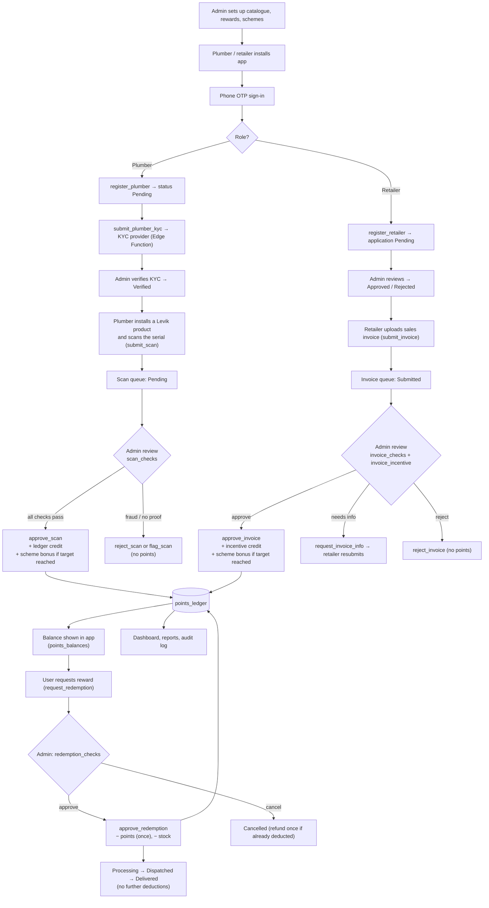

### 2.2 Onboarding and KYC (plumber)

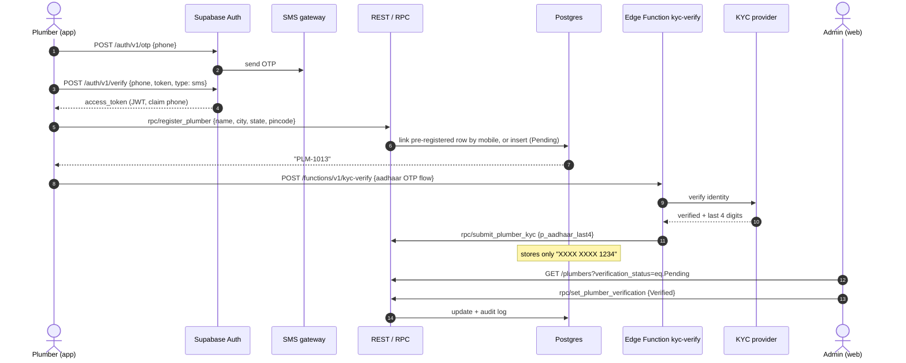

### 2.3 Scan to points (scenario A)

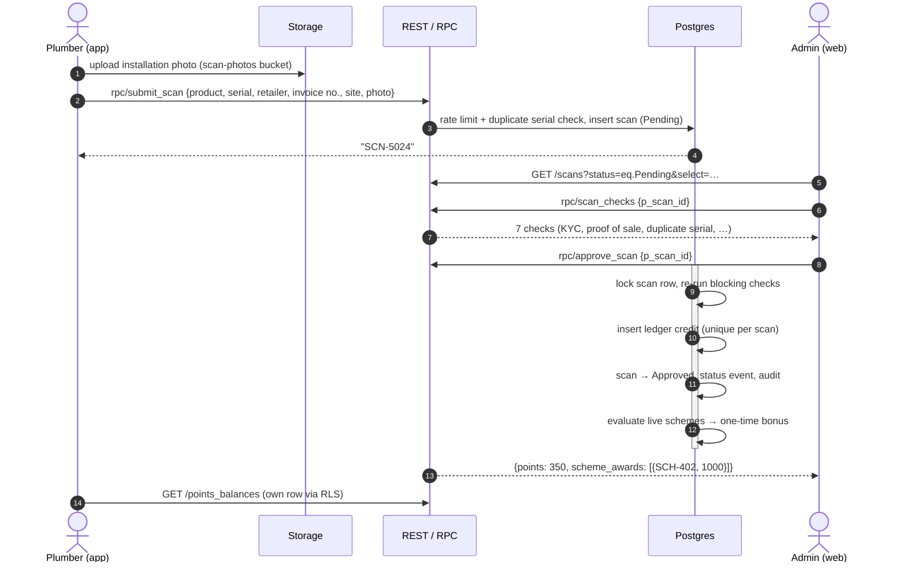

### 2.4 Invoice to incentive (scenario B)

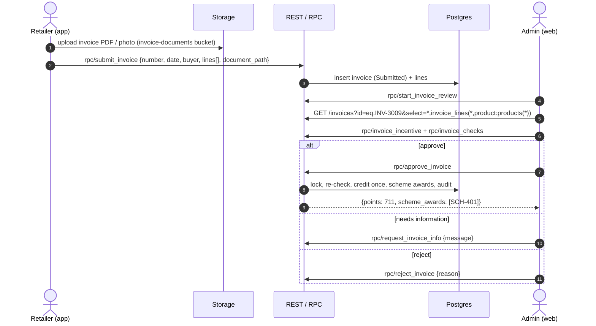

### 2.5 Reward redemption (scenario C)

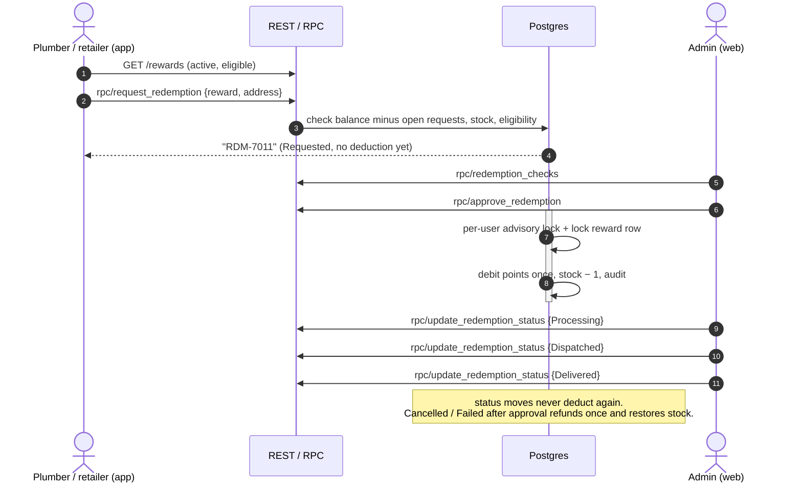

### 2.6 Status lifecycles

**Product scan**

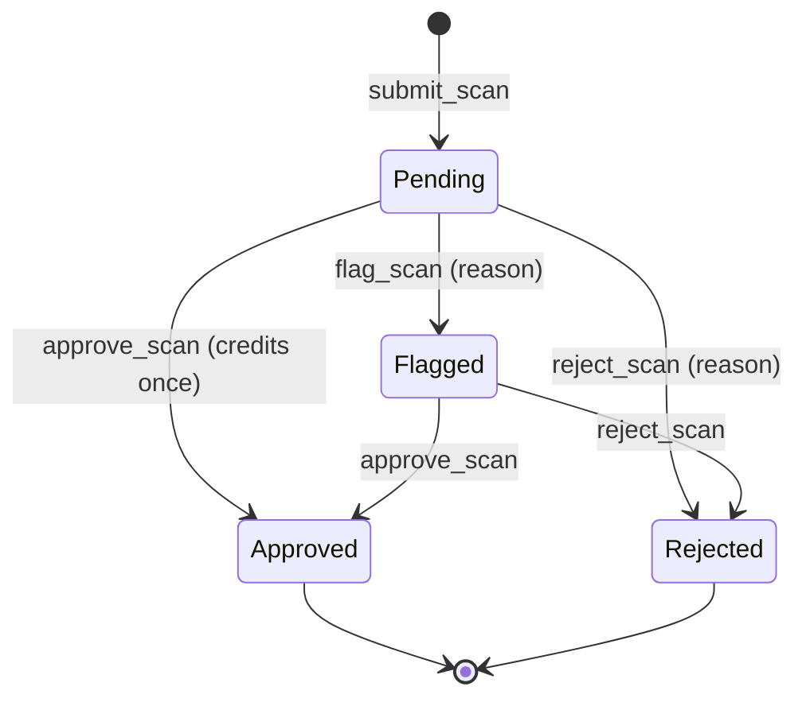

**Invoice**

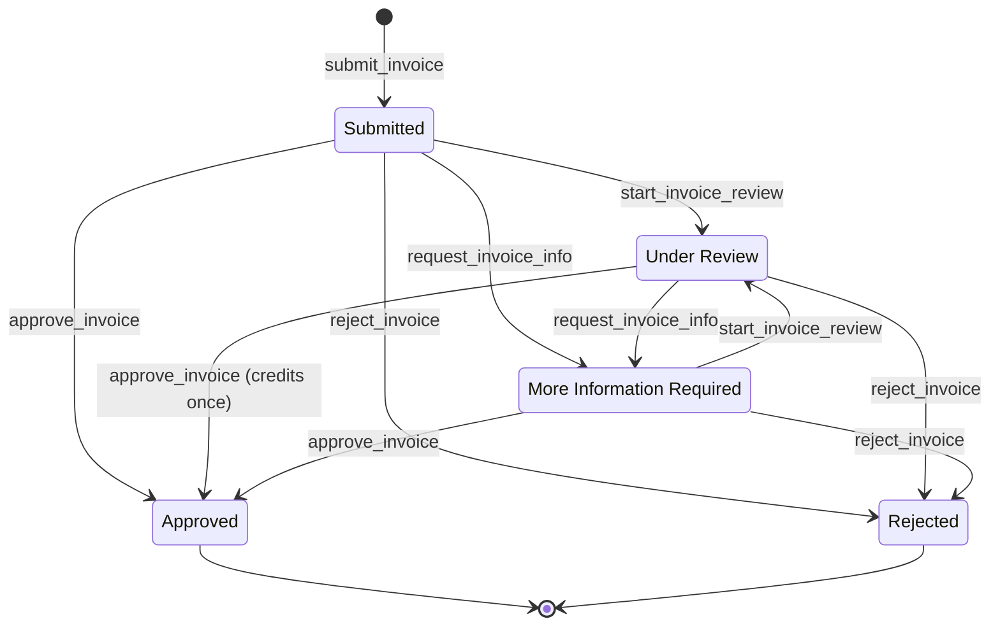

**Redemption**

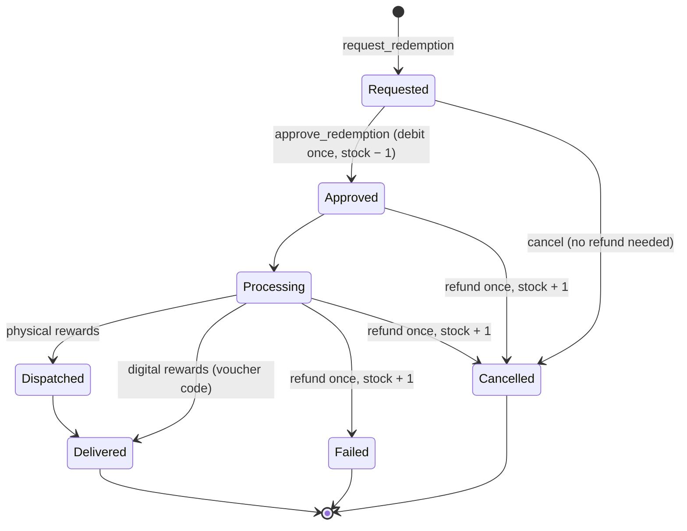

**Scheme**

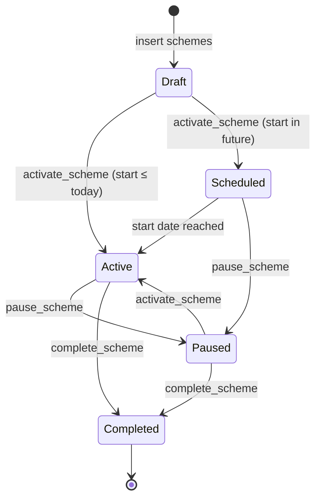

> 🟡 A `Scheduled` scheme does not yet switch to `Active` on its own. Planned: a nightly `pg_cron` job, `promote_scheduled_schemes()`. Bonuses only pay while a scheme is `Active` and within its dates.

### 2.7 Entity relationships

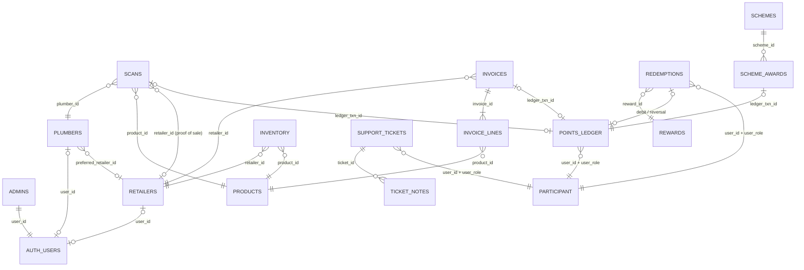

`PARTICIPANT` means "a plumber or a retailer". Polymorphic references are validated by the `assert_participant` trigger. `status_events` and `audit_logs` reference any entity by `entity_type` + `entity_id`.

---

## 3. API conventions

### 3.1 Base URLs and headers

| Item | Value |
| --- | --- |
| REST (tables / views) | `https://<project>.supabase.co/rest/v1/<table>` |
| RPC (functions) | `POST https://<project>.supabase.co/rest/v1/rpc/<function>` with a JSON body of named arguments |
| Auth | `https://<project>.supabase.co/auth/v1/...` |
| Storage | `https://<project>.supabase.co/storage/v1/...` |
| Edge Functions | `https://<project>.supabase.co/functions/v1/<name>` |
| Required headers | `apikey: <anon key>`, `Authorization: Bearer <user access token>`, `Content-Type: application/json` |

In code, use `@supabase/supabase-js`. For example, `supabase.from('scans').select(...)` maps to `GET /rest/v1/scans?select=...`, and `supabase.rpc('approve_scan', { p_scan_id })` maps to `POST /rest/v1/rpc/approve_scan`.

### 3.2 Query syntax used in this document

| Need | REST form | supabase-js |
| --- | --- | --- |
| Columns + joins | `select=*,plumber:plumbers(id,name,city)` | `.select('*, plumber:plumbers(id,name,city)')` |
| Filter | `status=eq.Pending`, `scanned_at=gte.2026-10-01`, `id=in.(A,B)` | `.eq()`, `.gte()`, `.in()` |
| Text search | `or=(name.ilike.*ram*,mobile.ilike.*ram*)` | `.or('name.ilike.%ram%,mobile.ilike.%ram%')` |
| Sort | `order=scanned_at.desc` | `.order('scanned_at', { ascending: false })` |
| Pagination | header `Range: 0-9` + `Prefer: count=exact` → response `Content-Range: 0-9/23` | `.range(0, 9)` with `{ count: 'exact' }` |
| Insert / update returning row | `Prefer: return=representation` | `.insert(...).select().single()` |

### 3.3 Data conventions

- **IDs** are readable text prefixes: `PLM-1001`, `RTL-2001`, `PRD-101`, `SCN-5001`, `INV-3001`, `RWD-6001`, `RDM-7001`, `SCH-401`, `STK-1`, `TKT-8001`, `TXN-90001`, `AUD-100001`.
- **Timestamps** are ISO-8601 with timezone (`timestamptz`). The UI shows them in IST.
- **Money** is a whole number of rupees (`bigint`). Invoice values are pre-GST. GST at 18% is computed for display only.
- **Points** are whole numbers (`int`).
- **JSON keys** are snake_case, exactly as the columns are named. The admin app's TypeScript types use camelCase, so the data layer maps between them.
- **Enum values** are human-readable strings, identical to the TypeScript unions (see §4.1).

---

## 4. Data schema and objects

### 4.1 Enumerations

| Enum | Values |
| --- | --- |
| `user_role` | `plumber`, `retailer` |
| `plumber_verification_status` | `Verified`, `Pending`, `Rejected` |
| `account_status` | `Active`, `Suspended`, `Inactive` (retailers: `Active`/`Suspended` only) |
| `retailer_verification_status` | `Approved`, `Pending`, `Rejected` |
| `product_category` | `One-Piece Western WC`, `Wall-Hung WC`, `Floor-Mounted EWC`, `Indian Pan`, `Half-Pedestal Basin`, `Pedestal Basin`, `Wall-Hung Basin`, `Countertop Basin`, `Urinal`, `Cistern`, `Kitchen Sink` |
| `scan_status` | `Pending`, `Approved`, `Rejected`, `Flagged` |
| `invoice_status` | `Submitted`, `Under Review`, `Approved`, `Rejected`, `More Information Required` |
| `points_source` | `Product Scan`, `Invoice Incentive`, `Scheme Bonus`, `Redemption`, `Redemption Reversal`, `Manual Adjustment`, `Opening Balance` |
| `related_entity` | `scan`, `invoice`, `redemption`, `scheme` |
| `reward_category` | `Shopping Voucher`, `Gift Card`, `Air Conditioner`, `Refrigerator`, `Television`, `Home Appliance`, `Tools & Equipment`, `Other` |
| `reward_type` | `Digital`, `Physical` |
| `redemption_status` | `Requested`, `Approved`, `Processing`, `Dispatched`, `Delivered`, `Cancelled`, `Failed` |
| `scheme_status` | `Draft`, `Scheduled`, `Active`, `Completed`, `Paused` |
| `scheme_target_type` | `Sales Amount` (retailer schemes, ₹), `Approved Scans` (plumber campaigns, count) |
| `ticket_status` | `Open`, `In Progress`, `Resolved`, `Closed` |
| `ticket_priority` | `Low`, `Medium`, `High` |
| `ticket_category` | `Points`, `Scan`, `Invoice`, `Redemption`, `Account`, `Product` |
| `audit_entity` | `Product`, `Plumber`, `Retailer`, `Scan`, `Invoice`, `Points`, `Reward`, `Redemption`, `Scheme`, `Inventory`, `Support`, `Settings`, `Session` |

### 4.2 Core objects (tables)

Types are written in TypeScript notation. `?` means nullable. Lines marked *(read-only)* cannot be written through the API: only the functions change them.

```ts
/** admins — Levik employees with admin access. */
interface Admin {
  user_id: string;           // uuid, FK auth.users
  name: string;              // editable by the admin themself (Settings)
  email: string;
  created_at: string;
}

/** plumbers */
interface Plumber {
  id: string;                // "PLM-1001"
  user_id?: string;          // linked auth user (phone login)
  name: string;
  mobile: string;            // "+91 98290 11234", unique
  email?: string;
  city: string;
  state: string;
  pincode: string;           // 6 digits
  registered_at: string;
  verification_status: PlumberVerificationStatus; // read-only → set_plumber_verification
  account_status: AccountStatus;                  // read-only → set_plumber_account_status
  aadhaar_masked?: string;   // "XXXX XXXX 1234" only
  experience_years: number;
  specialization: string;
  preferred_retailer_id?: string;
  verification_note?: string;
}

/** retailers */
interface Retailer {
  id: string;                // "RTL-2001"
  user_id?: string;
  shop_name: string;
  owner_name: string;
  mobile: string;            // unique
  email?: string;
  address: string;
  city: string;
  state: string;
  gstin?: string;            // validated 15-char GSTIN
  distributor: string;
  registered_at: string;
  verification_status: RetailerVerificationStatus; // read-only → review_retailer_application
  account_status: "Active" | "Suspended";          // read-only → set_retailer_account_status
  monthly_target: number;    // ₹
  rejection_reason?: string;
}

/** products — Levik catalogue */
interface Product {
  id: string;                // "PRD-101"
  name: string;
  model_code: string;        // "1012"
  category: ProductCategory;
  description: string;
  dimensions?: string;       // only if published in the catalogue
  features: string[];
  image_url?: string;        // Storage public URL (planned) or /images/products/…
  sku: string;               // unique
  barcode: string;           // 8–14 digits
  mrp: number;               // ₹
  plumber_points: number;    // points per approved scan
  is_active: boolean;
  reward_eligible: boolean;
  created_at: string;
  updated_at: string;
}

/** scans — plumber product scans */
interface Scan {
  id: string;                // "SCN-5001"
  plumber_id: string;
  product_id: string;
  submitted_code: string;    // serial printed on the product, upper-cased
  scanned_at: string;
  retailer_id?: string;      // proof of sale
  invoice_number?: string;
  site_location: string;
  photo_path?: string;       // Storage path in scan-photos
  status: ScanStatus;        // read-only
  awarded_points?: number;   // read-only
  ledger_txn_id?: string;    // read-only
  rejection_reason?: string;
  flag_reason?: string;
  reviewed_by?: string;
  reviewed_at?: string;
}

/** invoices + invoice_lines — retailer sales invoices */
interface Invoice {
  id: string;                // "INV-3001"
  invoice_number: string;
  retailer_id: string;
  buyer_name: string;
  invoice_date: string;
  submitted_at: string;
  document_path?: string;    // Storage path in invoice-documents
  status: InvoiceStatus;     // read-only
  reviewer?: string;
  reviewed_at?: string;
  incentive_points?: number; // read-only
  ledger_txn_id?: string;    // read-only
  rejection_reason?: string;
  info_request?: string;
  invoice_lines?: InvoiceLine[]; // via select=*,invoice_lines(*)
}
interface InvoiceLine {
  id: string;
  invoice_id: string;
  product_id: string;
  quantity: number;          // > 0
  unit_price: number;        // ₹, pre-GST
}

/** rewards — redemption catalogue */
interface Reward {
  id: string;                // "RWD-6001"
  name: string;
  category: RewardCategory;
  type: "Digital" | "Physical";
  description: string;
  points_required: number;
  stock: number;             // read-only after insert → adjust_reward_stock
  is_active: boolean;
  eligible_roles: UserRole[];
  created_at: string;
  updated_at: string;
}

/** redemptions */
interface Redemption {
  id: string;                // "RDM-7001"
  user_id: string;           // PLM-… or RTL-…
  user_role: UserRole;
  reward_id: string;
  points_cost: number;
  requested_at: string;
  status: RedemptionStatus;  // read-only
  delivery_address: string;
  debit_txn_id?: string;     // set once at approval
  reversal_txn_id?: string;  // set once on cancel/fail after approval
  fulfilment_ref?: string;
  voucher_code?: string;
  courier_name?: string;
  tracking_number?: string;
  cancel_reason?: string;
}

/** schemes + scheme_awards */
interface Scheme {
  id: string;                // "SCH-401"
  name: string;
  description: string;
  role: UserRole;
  start_date: string;
  end_date: string;
  eligible_categories: ProductCategory[];
  target_type: SchemeTargetType; // derived from role (trigger)
  target_value: number;      // ₹ (retailer) or scan count (plumber)
  incentive_points: number;  // one-time bonus per participant
  status: SchemeStatus;      // read-only → activate/pause/complete_scheme
  created_at: string;
  updated_at: string;
}
interface SchemeAward {
  scheme_id: string;
  user_id: string;
  awarded_at: string;
  ledger_txn_id: string;
}

/** inventory — retailer-reported stock (not warehouse stock) */
interface InventoryItem {
  id: string;                // "STK-1"
  retailer_id: string;
  product_id: string;
  quantity: number;          // ≥ 0
  updated_at: string;
  updated_by: string;
}

/** points_ledger — append-only */
interface PointsTransaction {
  id: string;                // "TXN-90001"
  user_id: string;
  user_role: UserRole;
  source: PointsSource;
  related_type?: "scan" | "invoice" | "redemption" | "scheme";
  related_id?: string;
  credit: number;            // exactly one of credit/debit is > 0
  debit: number;
  created_at: string;
  status: "Posted";
  note: string;
  created_by: string;        // admin name or "System"
}

/** support_tickets + ticket_notes */
interface SupportTicket {
  id: string;                // "TKT-8001"
  user_id: string;
  user_role: UserRole;
  subject: string;
  category: TicketCategory;
  description: string;
  priority: TicketPriority;
  status: TicketStatus;      // read-only → update_ticket
  created_at: string;
  updated_at: string;
}
interface TicketNote { id: number; ticket_id: string; at: string; by_name: string; body: string; }

/** status_events — history timeline for scans, invoices, redemptions (append-only) */
interface StatusEvent {
  id: number;
  entity_type: "scan" | "invoice" | "redemption";
  entity_id: string;
  at: string;
  by_name: string;
  action: string;            // "Approved", "Moved to review", …
  note?: string;
}

/** audit_logs — append-only */
interface AuditLog {
  id: string;                // "AUD-100001"
  at: string;
  admin_name: string;
  admin_user_id?: string;
  action: string;            // "Scan approved", "Product edited", …
  entity_type: AuditEntity;
  entity_id: string;
  summary: string;
}

/** settings — single row */
interface Settings {
  id: true;
  programme_name: string;
  retailer_points_per_100: number;  // incentive rate, 0.1–20
  low_stock_threshold: number;
  notifications: { pendingScans: boolean; pendingInvoices: boolean; redemptions: boolean; lowStock: boolean };
  max_daily_scans_per_plumber: number;
  updated_at: string;
}
```

### 4.3 Views

```ts
/** points_balances — derived from points_ledger (RLS applies) */
interface PointsBalance {
  user_id: string;
  user_role: UserRole;
  lifetime: number;    // credits excluding refunds
  redeemed: number;    // redemption debits minus refunds
  available: number;   // credits − debits
}

/** store_directory — approved, active shops for the plumber app (no GSTIN/email) */
interface StoreDirectoryEntry {
  id: string; shop_name: string; address: string; city: string; state: string; mobile: string;
}
```

### 4.4 Function result objects

```ts
/** scan_checks / invoice_checks / redemption_checks (one row per check) */
interface Check {
  label: string;      // "Plumber KYC verified"
  passed: boolean;
  blocking: boolean;  // approval is refused while any blocking check fails
  detail: string;     // "KYC status: Pending"
}

/** invoice_incentive (one row per invoice line) */
interface IncentiveLine {
  line_id: string;
  product_id: string;
  product_name: string;
  category: ProductCategory;
  quantity: number;
  unit_price: number;
  line_value: number;
  eligible: boolean;
  reason?: "Unknown product" | "Not reward-eligible" | "Product inactive";
  points: number;
}

/** approve_scan / approve_invoice */
interface ApprovalResult {
  points: number;
  ledger_txn_id: string | null;
  scheme_awards: Array<{ id: string; name: string; incentive_points: number }>;
}

/** scheme_participants */
interface SchemeParticipant {
  user_id: string;
  name: string;
  location: string;
  progress: number;   // ₹ or scan count
  percent: number;    // 0–100
  awarded: boolean;
}

/** my_scheme_progress (mobile) */
interface MySchemeProgress {
  scheme_id: string; name: string; description: string; status: SchemeStatus;
  start_date: string; end_date: string; target_type: SchemeTargetType;
  target_value: number; incentive_points: number; progress: number; awarded: boolean;
}
```

### 4.5 Planned objects (🟡)

```ts
/** dashboard_metrics(p_period) */
interface DashboardMetrics {
  kpis: {
    total_plumbers: number; verified_plumbers: number; active_retailers: number;
    product_scans: number; pending_scans: number; pending_invoices: number;
    active_schemes: number; points_issued: number; points_redeemed: number;
    pending_redemptions: number; verified_sales: number;
  };
  sales_trend: Array<{ bucket: string; label: string; sales: number; invoices: number }>;
  scan_trend: Array<{ bucket: string; label: string; approved: number; pending: number; rejected: number; flagged: number }>;
  points_trend: Array<{ bucket: string; label: string; earned: number; redeemed: number }>;
}

/** retailer_performance() — list columns for Retailers page */
interface RetailerPerformance { retailer_id: string; sales_30d: number; achievement_pct: number; }

/** global_search(p_query) */
interface SearchResult { type: "Plumber" | "Retailer" | "Product" | "Scan" | "Invoice" | "Redemption" | "Scheme"; id: string; title: string; subtitle: string; }

/** admin_notifications() */
interface AdminNotification { id: string; title: string; detail: string; href: string; count: number; }
```

---

## 5. Admin web app — endpoints by page

All admin endpoints require a signed-in user whose `auth.uid()` exists in `public.admins`. Functions return error `42501` "Only programme administrators can perform this action" otherwise.

### 5.1 Login (`/login`)

| # | Action | Endpoint | Status |
| --- | --- | --- | --- |
| L1 | Sign in | `POST /auth/v1/token?grant_type=password` body `{ email, password }` → `{ access_token, refresh_token, user }` | ✅ |
| L2 | Confirm admin role | `POST /rest/v1/rpc/is_admin` → `boolean`. If `false`, sign out and show "Not an administrator". | ✅ |
| L3 | Load admin profile | `GET /rest/v1/admins?user_id=eq.<uid>&select=*` → `Admin` | ✅ |
| L4 | Sign out | `POST /auth/v1/logout` | ✅ |
| L5 | Forgot password | `POST /auth/v1/recover` body `{ email }` | ✅ (Supabase Auth) |

Supabase Auth records sign-ins in its own audit log. The admin's "Session" audit entries move there.

### 5.2 App shell (sidebar badges, global search, notifications, profile)

| # | Action | Endpoint | Status |
| --- | --- | --- | --- |
| S1 | Sidebar counts | `HEAD /rest/v1/scans?status=eq.Pending` with `Prefer: count=exact` → `Content-Range`. Same for `invoices?status=in.(Submitted,"Under Review")`, `redemptions?status=eq.Requested` and `retailers?verification_status=eq.Pending`. | ✅ |
| S2 | Notifications menu | S1 counts + `GET /rest/v1/inventory?quantity=lte.<low_stock_threshold>&select=id` + `GET /rest/v1/settings` (the `notifications` flags) | ✅ |
| S2b | Single call | `POST /rest/v1/rpc/admin_notifications` → `AdminNotification[]` | 🟡 |
| S3 | Global search | `POST /rest/v1/rpc/global_search` body `{ p_query }` → `SearchResult[]` (max 8, uses trigram indexes). Interim: parallel `ilike` queries on plumbers, retailers, products, scans, invoices, redemptions and schemes. | 🟡 |
| S4 | Profile | `GET /rest/v1/admins?user_id=eq.<uid>` | ✅ |

### 5.3 Dashboard (`/dashboard`)

| # | Widget | Endpoint | Status |
| --- | --- | --- | --- |
| D1 | All KPIs + 3 trend charts for a period (`7d`/`30d`/`90d`/`all`) | `POST /rest/v1/rpc/dashboard_metrics` body `{ p_period }` → `DashboardMetrics` | 🟡 |
| D1-interim | KPIs from counts | `HEAD` count queries on plumbers, retailers, scans, invoices, schemes and redemptions; points from `GET /points_ledger?created_at=gte.<start>&select=source,credit,debit` | ✅ |
| D2 | Scheme performance | `GET /rest/v1/schemes?status=in.(Active,Scheduled)` then `rpc/scheme_participants { p_scheme_id }` per scheme | ✅ |
| D3 | Recent scans | `GET /rest/v1/scans?select=id,status,scanned_at,plumber:plumbers(name),product:products(model_code)&order=scanned_at.desc&limit=5` | ✅ |
| D4 | Pending invoice queue | `GET /rest/v1/invoices?status=in.(Submitted,"Under Review")&select=id,invoice_number,status,retailer:retailers(shop_name),invoice_lines(quantity,unit_price)&order=submitted_at.desc&limit=5` | ✅ |
| D5 | Recent redemptions | `GET /rest/v1/redemptions?select=*,reward:rewards(name)&order=requested_at.desc&limit=5`. Resolve user names from plumbers/retailers by id. | ✅ |

### 5.4 Plumbers (`/plumbers`, `/plumbers/[id]`)

**List**

| # | Action | Endpoint | Status |
| --- | --- | --- | --- |
| P1 | Directory with filters, search, pagination | `GET /rest/v1/plumbers?select=*&verification_status=eq.<v>&account_status=eq.<a>&state=eq.<s>&or=(name.ilike.*q*,id.ilike.*q*,mobile.ilike.*q*,city.ilike.*q*)&order=id.asc` + `Range` | ✅ |
| P2 | Lifetime / available points | `GET /rest/v1/points_balances?user_role=eq.plumber` (merge by `user_id`) | ✅ |

**Detail**

| # | Action | Endpoint | Status |
| --- | --- | --- | --- |
| P3 | Profile | `GET /rest/v1/plumbers?id=eq.PLM-1001&select=*,preferred_retailer:retailers(id,shop_name)` | ✅ |
| P4 | Balance | `GET /rest/v1/points_balances?user_id=eq.PLM-1001` | ✅ |
| P5 | Scan history tab | `GET /rest/v1/scans?plumber_id=eq.PLM-1001&select=*,product:products(model_code,category),retailer:retailers(shop_name)&order=scanned_at.desc` | ✅ |
| P6 | Points ledger tab | `GET /rest/v1/points_ledger?user_id=eq.PLM-1001&order=created_at.desc` | ✅ |
| P7 | Redemptions tab | `GET /rest/v1/redemptions?user_id=eq.PLM-1001&select=*,reward:rewards(name,type)` | ✅ |
| P8 | Edit profile | `PATCH /rest/v1/plumbers?id=eq.PLM-1001` body `{ name, mobile, email, city, state, pincode, experience_years, specialization }` (audited by trigger) | ✅ |
| P9 | Verify / reject KYC | `rpc/set_plumber_verification { p_plumber_id, p_status: "Verified" \| "Rejected", p_note }`. A reason is required for `Rejected`. | ✅ |
| P10 | Suspend / reactivate | `rpc/set_plumber_account_status { p_plumber_id, p_status, p_reason }` | ✅ |
| P11 | Adjust points | `rpc/adjust_points { p_user_id, p_amount (±), p_reason }` → `TXN-…`. Cannot overdraw. | ✅ |

### 5.5 Retailers (`/retailers`, `/retailers/[id]`)

| # | Action | Endpoint | Status |
| --- | --- | --- | --- |
| R1 | Directory | `GET /rest/v1/retailers?select=*&verification_status=…&account_status=…&state=…&or=(shop_name.ilike.*q*,owner_name.ilike.*q*,gstin.ilike.*q*,city.ilike.*q*)` | ✅ |
| R2 | Sales 30 days + target achievement | `rpc/retailer_performance` → `RetailerPerformance[]`. Interim: `GET /invoices?status=eq.Approved&invoice_date=gte.<now-30d>&select=retailer_id,invoice_lines(quantity,unit_price)` and aggregate. | 🟡 |
| R3 | Detail | `GET /rest/v1/retailers?id=eq.RTL-2001` + `points_balances?user_id=eq.RTL-2001` | ✅ |
| R4 | Invoices tab | `GET /rest/v1/invoices?retailer_id=eq.RTL-2001&select=*,invoice_lines(quantity,unit_price)&order=submitted_at.desc` | ✅ |
| R5 | Inventory tab | `GET /rest/v1/inventory?retailer_id=eq.RTL-2001&select=*,product:products(name,model_code,category)` | ✅ |
| R6 | Schemes tab | `GET /rest/v1/schemes?role=eq.retailer&status=in.(Active,Scheduled)` + `rpc/scheme_participants` (filter the row for this retailer) + `scheme_awards?user_id=eq.RTL-2001` | ✅ |
| R7 | Incentive history | `GET /rest/v1/points_ledger?user_id=eq.RTL-2001&order=created_at.desc` | ✅ |
| R8 | Edit shop | `PATCH /rest/v1/retailers?id=eq.RTL-2001` body `{ shop_name, owner_name, mobile, email, address, city, state, gstin, distributor, monthly_target }` | ✅ |
| R9 | Approve / reject application | `rpc/review_retailer_application { p_retailer_id, p_decision, p_reason }` (Pending only) | ✅ |
| R10 | Suspend / reactivate | `rpc/set_retailer_account_status { p_retailer_id, p_status, p_reason }` | ✅ |
| R11 | Adjust points | `rpc/adjust_points` | ✅ |

### 5.6 Product catalogue (`/products`, `/products/[id]`)

| # | Action | Endpoint | Status |
| --- | --- | --- | --- |
| C1 | Grid / table with filters | `GET /rest/v1/products?select=*&category=eq.<c>&is_active=eq.<bool>&or=(name.ilike.*q*,model_code.ilike.*q*,sku.ilike.*q*)&order=id` | ✅ |
| C2 | Detail | `GET /rest/v1/products?id=eq.PRD-103` | ✅ |
| C3 | Retailer-reported stock | `GET /rest/v1/inventory?product_id=eq.PRD-103&select=*,retailer:retailers(shop_name)` | ✅ |
| C4 | Scans of this model | `GET /rest/v1/scans?product_id=eq.PRD-103&select=*,plumber:plumbers(name,city)&order=scanned_at.desc&limit=5` | ✅ |
| C5 | Add product | `POST /rest/v1/products` (`Prefer: return=representation`) body `ProductInput`. The returned `id` drives the redirect. | ✅ |
| C6 | Edit product | `PATCH /rest/v1/products?id=eq.PRD-103` body `Partial<ProductInput>` | ✅ |
| C7 | Activate / deactivate | `PATCH /rest/v1/products?id=eq.PRD-103` body `{ is_active }` | ✅ |
| C8 | Upload image | `POST /storage/v1/object/product-images/<id>.jpg` then `PATCH products { image_url }` | 🟡 bucket |

`ProductInput = { name, model_code, category, description, dimensions?, features[], image_url?, sku, barcode, mrp, plumber_points, is_active, reward_eligible }`

Errors: `23505` duplicate `sku`; `23514` invalid barcode, MRP or points.

### 5.7 Inventory (`/inventory`)

| # | Action | Endpoint | Status |
| --- | --- | --- | --- |
| V1 | List + filters | `GET /rest/v1/inventory?select=*,product:products(name,model_code,category),retailer:retailers(shop_name)&retailer_id=eq.<r>&order=quantity.asc`. Stock status is computed in the client with `settings.low_stock_threshold`. | ✅ |
| V2 | KPI counts | `HEAD inventory?quantity=eq.0` and `HEAD inventory?quantity=lte.<threshold>` with `count=exact` | ✅ |
| V3 | Update reported quantity | `PATCH /rest/v1/inventory?id=eq.STK-3` body `{ quantity, updated_by }` (audited) | ✅ |

### 5.8 Product scans (`/scans`, `/scans/[id]`)

| # | Action | Endpoint | Status |
| --- | --- | --- | --- |
| SC1 | Tabs with counts | `HEAD scans?status=eq.<tab>` with `count=exact` (×5) | ✅ |
| SC2 | Queue | `GET /rest/v1/scans?status=eq.Pending&retailer_id=eq.<r>&select=*,plumber:plumbers(id,name,city),product:products(id,model_code,category,plumber_points,reward_eligible),retailer:retailers(id,shop_name)&order=scanned_at.desc` + `Range`. Search: `or=(id.ilike.*q*,submitted_code.ilike.*q*,invoice_number.ilike.*q*)`. | ✅ |
| SC3 | Detail | `GET /rest/v1/scans?id=eq.SCN-5007&select=*,plumber:plumbers(*),product:products(*),retailer:retailers(*)` | ✅ |
| SC4 | Plumber balance | `GET /rest/v1/points_balances?user_id=eq.<plumber_id>` | ✅ |
| SC5 | Linked invoice | `GET /rest/v1/invoices?retailer_id=eq.<r>&invoice_number=eq.<n>&select=id,status` | ✅ |
| SC6 | Verification checks | `rpc/scan_checks { p_scan_id }` → `Check[]` | ✅ |
| SC7 | Scheme progress preview | `GET schemes?role=eq.plumber&status=eq.Active` + `rpc/scheme_participants` (filter for this plumber, show +1) | ✅ |
| SC7b | One call | `rpc/scan_scheme_impact { p_scan_id }` → `{ scheme, before, after, will_award }[]` | 🟡 |
| SC8 | History timeline | `GET /rest/v1/status_events?entity_type=eq.scan&entity_id=eq.SCN-5007&order=at` | ✅ |
| SC9 | Approve | `rpc/approve_scan { p_scan_id, p_note? }` → `ApprovalResult` | ✅ |
| SC10 | Reject | `rpc/reject_scan { p_scan_id, p_reason }` | ✅ |
| SC11 | Flag | `rpc/flag_scan { p_scan_id, p_reason }` (Pending only) | ✅ |

Approval errors: "This scan is already approved and credited."; "Cannot approve: Plumber KYC verified, Serial code not previously credited."; "Rejected scans cannot be approved."

### 5.9 Invoice management (`/invoices`, `/invoices/[id]`)

| # | Action | Endpoint | Status |
| --- | --- | --- | --- |
| IN1 | Tabs + list | `GET /rest/v1/invoices?status=eq.<tab>&retailer_id=eq.<r>&select=*,retailer:retailers(shop_name,city),invoice_lines(quantity,unit_price)&order=submitted_at.desc`. Amount = Σ quantity × unit_price. | ✅ |
| IN2 | Detail with lines | `GET /rest/v1/invoices?id=eq.INV-3009&select=*,retailer:retailers(*),invoice_lines(*,product:products(id,name,sku,category))` | ✅ |
| IN3 | Incentive calculation | `rpc/invoice_incentive { p_invoice_id }` → `IncentiveLine[]` (total = floor of the eligible value × rate) | ✅ |
| IN4 | Validation checks | `rpc/invoice_checks { p_invoice_id }` → `Check[]` | ✅ |
| IN5 | Document preview | `POST /storage/v1/object/sign/invoice-documents/<document_path>` body `{ expiresIn: 300 }` → signed URL. Falls back to the generated preview. | 🟡 bucket |
| IN6 | History | `GET /rest/v1/status_events?entity_type=eq.invoice&entity_id=eq.INV-3009&order=at` | ✅ |
| IN7 | Start review | `rpc/start_invoice_review { p_invoice_id }` | ✅ |
| IN8 | Approve | `rpc/approve_invoice { p_invoice_id }` → `ApprovalResult` | ✅ |
| IN9 | Reject | `rpc/reject_invoice { p_invoice_id, p_reason }` | ✅ |
| IN10 | Request info | `rpc/request_invoice_info { p_invoice_id, p_message }` | ✅ |
| IN11 | Scheme impact preview | `rpc/invoice_scheme_impact { p_invoice_id }` | 🟡 |

### 5.10 Rewards catalogue (`/rewards`)

| # | Action | Endpoint | Status |
| --- | --- | --- | --- |
| RW1 | List + filters | `GET /rest/v1/rewards?select=*&category=eq.<c>&is_active=eq.<b>&order=points_required` | ✅ |
| RW2 | Redemption count per reward | `GET /rest/v1/redemptions?select=reward_id,debit_txn_id,reversal_txn_id` (aggregate in the client) | ✅ |
| RW3 | Add reward | `POST /rest/v1/rewards` body `{ name, category, type, description, points_required, stock, is_active, eligible_roles }` | ✅ |
| RW4 | Edit reward | `PATCH /rest/v1/rewards?id=eq.RWD-6001` (all of the above except `stock`) | ✅ |
| RW5 | Activate / deactivate | `PATCH rewards { is_active }` | ✅ |
| RW6 | Adjust stock | `rpc/adjust_reward_stock { p_reward_id, p_delta, p_reason }` → new stock. Never below 0. | ✅ |
| RW7 | Redemption history | `GET /rest/v1/redemptions?reward_id=eq.RWD-6001&order=requested_at.desc` | ✅ |

### 5.11 Redemptions (`/redemptions`, `/redemptions/[id]`)

| # | Action | Endpoint | Status |
| --- | --- | --- | --- |
| RD1 | Tabs + list | `GET /rest/v1/redemptions?status=eq.<tab>&user_role=eq.<role>&select=*,reward:rewards(name,type,category)&order=requested_at.desc`. User names are resolved from plumbers/retailers with `id=in.(…)`. | ✅ |
| RD2 | Detail | `GET /rest/v1/redemptions?id=eq.RDM-7004&select=*,reward:rewards(*)` + the user row + `points_balances?user_id=eq.<user>` | ✅ |
| RD3 | Eligibility checks | `rpc/redemption_checks { p_redemption_id }` → `Check[]` | ✅ |
| RD4 | Ledger entries | `GET /rest/v1/points_ledger?related_type=eq.redemption&related_id=eq.RDM-7004` | ✅ |
| RD5 | History | `GET /rest/v1/status_events?entity_type=eq.redemption&entity_id=eq.RDM-7004&order=at` | ✅ |
| RD6 | Approve (debit once) | `rpc/approve_redemption { p_redemption_id }` | ✅ |
| RD7 | Move along fulfilment | `rpc/update_redemption_status { p_redemption_id, p_next: "Processing" \| "Dispatched" \| "Delivered" }` | ✅ |
| RD8 | Cancel / fail | `rpc/update_redemption_status { p_redemption_id, p_next: "Cancelled" \| "Failed", p_reason }`. Refunds once if points were already deducted. | ✅ |
| RD9 | Real courier / voucher references | Admin-entered fields on dispatch (planned: `p_courier`, `p_tracking`, `p_voucher_code` arguments) | 🟡 |

### 5.12 Points ledger (`/ledger`)

| # | Action | Endpoint | Status |
| --- | --- | --- | --- |
| LG1 | List + filters | `GET /rest/v1/points_ledger?user_role=eq.<r>&source=eq.<s>&credit=gt.0` (or `debit=gt.0`)`&or=(id.ilike.*q*,user_id.ilike.*q*,note.ilike.*q*,related_id.ilike.*q*)&order=created_at.desc` + `Range` | ✅ |
| LG2 | Totals for filter | `rpc/ledger_totals { filters }` → `{ credited, debited }`. Interim: sum the fetched page. | 🟡 |
| LG3 | Transaction detail | `GET /rest/v1/points_ledger?id=eq.TXN-90046`. The link to the related scan, invoice, redemption or scheme comes from `related_type` / `related_id`. | ✅ |

### 5.13 Schemes (`/schemes`, `/schemes/new`, `/schemes/[id]`, `/schemes/[id]/edit`)

| # | Action | Endpoint | Status |
| --- | --- | --- | --- |
| SH1 | List + tabs | `GET /rest/v1/schemes?status=eq.<tab>&order=start_date.desc` | ✅ |
| SH2 | Card progress | `rpc/scheme_participants { p_scheme_id }` per card (average of `percent`) | ✅ |
| SH3 | Create (Draft) | `POST /rest/v1/schemes` body `{ name, description, role, start_date, end_date, eligible_categories, target_value, incentive_points }`. Status is forced to `Draft` and `target_type` is derived. | ✅ |
| SH4 | Edit | `PATCH /rest/v1/schemes?id=eq.SCH-406` (same fields). RLS allows this only while `Draft` / `Scheduled`. | ✅ |
| SH5 | Detail | `GET /rest/v1/schemes?id=eq.SCH-401` + `rpc/scheme_participants` + `GET /scheme_awards?scheme_id=eq.SCH-401` | ✅ |
| SH6 | Activate / resume | `rpc/activate_scheme { p_scheme_id }` → `"Active"` or `"Scheduled"` | ✅ |
| SH7 | Pause | `rpc/pause_scheme { p_scheme_id, p_reason }` | ✅ |
| SH8 | Complete | `rpc/complete_scheme { p_scheme_id }` | ✅ |

### 5.14 Support tickets (`/support`)

| # | Action | Endpoint | Status |
| --- | --- | --- | --- |
| SU1 | List + tabs + priority | `GET /rest/v1/support_tickets?status=eq.<tab>&priority=eq.<p>&order=updated_at.desc` | ✅ |
| SU2 | Ticket notes | `GET /rest/v1/ticket_notes?ticket_id=eq.TKT-8001&order=at` | ✅ |
| SU3 | Update status / add note | `rpc/update_ticket { p_ticket_id, p_status, p_note? }` | ✅ |

### 5.15 Reports (`/reports`)

Every report takes the period filter (`p_from`, `p_to`). CSV export is built in the client from the same rows.

| # | Report | Endpoint | Status |
| --- | --- | --- | --- |
| RP1 | Verified sales by period | `rpc/report_sales_by_period { p_from, p_to, p_bucket: "day" \| "week" \| "month" }` → `{ bucket, sales, invoices }[]` | 🟡 |
| RP2 | Scans by status | `rpc/report_scans_by_status { p_from, p_to }` → `{ status, count }[]` | 🟡 |
| RP3 | Points issued vs redeemed | `rpc/report_points_by_period { p_from, p_to, p_bucket }` → `{ bucket, issued, redeemed }[]` | 🟡 |
| RP4 | Top retailers | `rpc/report_top_retailers { p_from, p_to, p_limit }` → `{ retailer_id, name, city, invoices, sales, points }[]` | 🟡 |
| RP5 | Top-scanned products | `rpc/report_top_products { p_from, p_to, p_limit }` → `{ product_id, name, model_code, scans, approved, points }[]` | 🟡 |
| RP6 | Scheme performance | `GET schemes` + `rpc/scheme_participants` per scheme | ✅ |

Interim until the report functions exist: fetch the filtered rows (`invoices`, `scans`, `points_ledger`) and aggregate in the client, as the demo does today.

### 5.16 Settings (`/settings`)

| # | Action | Endpoint | Status |
| --- | --- | --- | --- |
| ST1 | Read | `GET /rest/v1/settings?select=*` + `GET /rest/v1/admins?user_id=eq.<uid>` | ✅ |
| ST2 | Admin display name | `PATCH /rest/v1/admins?user_id=eq.<uid>` body `{ name }` | ✅ |
| ST3 | Programme settings | `PATCH /rest/v1/settings?id=eq.true` body `{ programme_name, retailer_points_per_100, low_stock_threshold, max_daily_scans_per_plumber }` (audited) | ✅ |
| ST4 | Notification preferences | `PATCH /rest/v1/settings?id=eq.true` body `{ notifications }` | ✅ |
| ST5 | Reset demo data | Demo build only. On Supabase this is `supabase db reset` on a non-production project. Never exposed as an API. | n/a |

### 5.17 Audit logs (`/audit-logs`)

| # | Action | Endpoint | Status |
| --- | --- | --- | --- |
| AU1 | List + filters | `GET /rest/v1/audit_logs?entity_type=eq.<e>&admin_name=eq.<a>&or=(action.ilike.*q*,entity_id.ilike.*q*,summary.ilike.*q*)&order=at.desc` + `Range` | ✅ |
| AU2 | Filter options | `rpc/audit_filter_options` → `{ entity_types[], admins[] }`. Interim: the enum list + `select=admin_name`. | 🟡 |
| AU3 | Export CSV | Client-side from AU1 rows (page through with `Range`) | ✅ |

---

## 6. Mobile app — endpoints by screen

Participants sign in with phone OTP. Every read returns only their own rows (RLS). Every write is a function.

### 6.1 Onboarding

| # | Screen / action | Endpoint | Status |
| --- | --- | --- | --- |
| M1 | Send OTP | `POST /auth/v1/otp` body `{ phone: "+919829011234" }` | ✅ (needs SMS provider) |
| M2 | Verify OTP | `POST /auth/v1/verify` body `{ type: "sms", phone, token }` → session | ✅ |
| M3 | Who am I | `GET /rest/v1/plumbers?select=*` and `GET /rest/v1/retailers?select=*` (RLS returns 0 or 1 row each) | ✅ |
| M4 | Register as plumber | `rpc/register_plumber { p_name, p_city, p_state, p_pincode, p_experience_years?, p_specialization?, p_preferred_retailer_id? }` → `PLM-…`. Links an existing row with the same mobile if an admin pre-registered the user. | ✅ |
| M5 | Register as retailer | `rpc/register_retailer { p_shop_name, p_owner_name, p_address, p_city, p_state, p_gstin?, p_distributor? }` → `RTL-…` | ✅ |
| M6 | Aadhaar KYC | `POST /functions/v1/kyc-verify`. The Edge Function talks to the KYC provider, then calls `rpc/submit_plumber_kyc { p_aadhaar_last4 }`. | 🟡 Edge Function · ✅ RPC |

### 6.2 Plumber screens

| # | Screen | Endpoint | Status |
| --- | --- | --- | --- |
| MP1 | Home: points card | `GET /rest/v1/points_balances` | ✅ |
| MP2 | Home: progress to next reward | `GET /rest/v1/rewards?eligible_roles=cs.{plumber}&order=points_required` | ✅ |
| MP3 | Home: offers / campaigns | `rpc/my_scheme_progress` → `MySchemeProgress[]` | ✅ |
| MP4 | Scan: resolve product from barcode | `GET /rest/v1/products?barcode=eq.<code>&select=id,name,model_code,image_url,plumber_points` | ✅ |
| MP5 | Scan: choose the shop it was bought from | `GET /rest/v1/store_directory?city=eq.<city>&order=shop_name` | ✅ |
| MP6 | Scan: upload photo | `POST /storage/v1/object/scan-photos/<user_id>/<uuid>.jpg` | 🟡 bucket |
| MP7 | Scan: submit | `rpc/submit_scan { p_product_id, p_serial, p_retailer_id?, p_invoice_number?, p_site_location?, p_photo_path? }` → `SCN-…` | ✅ |
| MP8 | My scans + statuses | `GET /rest/v1/scans?select=*,product:products(name,model_code,image_url)&order=scanned_at.desc` | ✅ |
| MP9 | Wallet / earnings | `GET /rest/v1/points_ledger?order=created_at.desc` + `points_balances` | ✅ |
| MP10 | Rewards catalogue | `GET /rest/v1/rewards?is_active=eq.true&eligible_roles=cs.{plumber}&order=points_required` | ✅ |
| MP11 | Redeem | `rpc/request_redemption { p_reward_id, p_delivery_address }` → `RDM-…` | ✅ |
| MP12 | My redemptions / tracking | `GET /rest/v1/redemptions?select=*,reward:rewards(name,type)&order=requested_at.desc` | ✅ |
| MP13 | Cancel a request | `rpc/cancel_my_redemption { p_redemption_id }` (Requested only) | ✅ |
| MP14 | Nearby stores | `GET /rest/v1/store_directory?city=eq.<city>`. Distance sorting needs shop coordinates. | ✅ (🟡 geo) |
| MP15 | Product catalogue | `GET /rest/v1/products?is_active=eq.true&select=id,name,model_code,category,dimensions,image_url,plumber_points` | ✅ |
| MP16 | Support | `rpc/raise_ticket { p_subject, p_category, p_description, p_priority? }`; `GET /rest/v1/support_tickets` | ✅ |
| MP17 | Profile | `GET /rest/v1/plumbers` (own row). Self-edit of profile fields is planned: `rpc/update_my_profile`. | ✅ / 🟡 |
| MP18 | Push notifications (scan approved, reward shipped) | `POST /rest/v1/rpc/register_device { p_token }` + database-webhook Edge Function `notify` | 🟡 |

### 6.3 Retailer screens

| # | Screen | Endpoint | Status |
| --- | --- | --- | --- |
| MR1 | Home: incentive balance | `GET /rest/v1/points_balances` | ✅ |
| MR2 | Home: monthly target ring | `GET /rest/v1/retailers` (`monthly_target`) + `rpc/retailer_performance` (own row) | 🟡 |
| MR3 | Schemes & progress | `rpc/my_scheme_progress` | ✅ |
| MR4 | Explore products | `GET /rest/v1/products?is_active=eq.true&category=eq.<c>` | ✅ |
| MR5 | My inventory | `GET /rest/v1/inventory?select=*,product:products(name,model_code)` | ✅ |
| MR6 | Update stock | `rpc/report_inventory { p_product_id, p_quantity }` (upsert) | ✅ |
| MR7 | Upload invoice document | `POST /storage/v1/object/invoice-documents/<retailer_id>/<uuid>.pdf` | 🟡 bucket |
| MR8 | Submit invoice | `rpc/submit_invoice { p_invoice_number, p_invoice_date, p_buyer_name, p_lines: [{ product_id, quantity, unit_price? }], p_document_path? }` → `INV-…` | ✅ |
| MR9 | Invoice history + status | `GET /rest/v1/invoices?select=*,invoice_lines(*)&order=submitted_at.desc` | ✅ |
| MR10 | Incentive preview | `rpc/invoice_incentive { p_invoice_id }` (own invoices only) | ✅ |
| MR11 | Rewards / redeem / track | Same as MP10–MP13, with `eligible_roles=cs.{retailer}` | ✅ |
| MR12 | Verify plumber scans at my store | `rpc/retailer_confirm_scan { p_scan_id, p_confirmed }`. Adds a "retailer confirmed" check to `scan_checks`. | 🟡 |
| MR13 | Support | `rpc/raise_ticket`; `GET /rest/v1/support_tickets` | ✅ |

---

## 7. Storage, Edge Functions and integrations

| Item | Purpose | Access rules | Status |
| --- | --- | --- | --- |
| Bucket `invoice-documents` (private) | Retailer invoice PDFs and photos | Retailer can upload to `/<own retailer_id>/…`. Admins read through signed URLs. | 🟡 |
| Bucket `scan-photos` (private) | Installation photos for scans | Plumber can upload to `/<own plumber_id>/…`. Admins read through signed URLs. | 🟡 |
| Bucket `product-images` (public) | Catalogue images | Admin can write. Anyone can read. | 🟡 |
| Edge Function `kyc-verify` | Aadhaar / DigiLocker verification through the provider. Stores only the last 4 digits. | Plumber JWT. Calls the DB with the service role. | 🟡 |
| Auth hook `send-sms` | Sends OTP through MSG91 using the registered DLT template | Supabase Auth | 🟡 |
| Edge Function `notify` | Push and SMS on scan, invoice and redemption status changes (database webhook on `status_events` insert) | Service role | 🟡 |
| `pg_cron` job `promote_scheduled_schemes` | Moves `Scheduled` schemes to `Active` on their start date, and `Active` to `Completed` after the end date | Database | 🟡 |

---

## 8. Access matrix

| Resource | Admin | Plumber | Retailer | Anonymous |
| --- | --- | --- | --- | --- |
| plumbers | read all; edit profile columns | read own | – | ✗ |
| retailers | read all; edit shop columns | – (uses `store_directory`) | read own | ✗ |
| products | read all; insert/edit | read active | read active | ✗ |
| scans | read all; status via RPC | read own; create via `submit_scan` | – | ✗ |
| invoices + lines | read all; status via RPC | – | read own; create via `submit_invoice` | ✗ |
| rewards | read all; insert/edit (stock via RPC) | read active | read active | ✗ |
| redemptions | read all; status via RPC | read own; request/cancel via RPC | read own; request/cancel via RPC | ✗ |
| points_ledger / points_balances | read all | read own | read own | ✗ |
| schemes | read all; create/edit Draft and Scheduled; status via RPC | read Active/Scheduled/Completed plumber schemes | read retailer schemes | ✗ |
| scheme_awards | read all | read own | read own | ✗ |
| inventory | read all; edit quantity | – | read own; upsert via `report_inventory` | ✗ |
| support_tickets | read all; status via RPC | read own; create via `raise_ticket` | read own; create via `raise_ticket` | ✗ |
| ticket_notes, status_events, audit_logs | read | ✗ | ✗ | ✗ |
| settings | read + edit | read | read | ✗ |
| Admin RPCs | ✓ | ✗ (`42501`) | ✗ (`42501`) | ✗ (no execute grant) |

---

## 9. Errors

Function and REST errors come back as HTTP 400, 401 or 403 with a body in this shape:

```json
{ "code": "P0001", "message": "Cannot approve: Plumber KYC verified.", "details": null, "hint": null }
```

| Code | Meaning | Example message | UI handling |
| --- | --- | --- | --- |
| `P0001` | Business rule violation (raised by a function) | "This scan is already approved and credited." · "Not enough points for this reward." · "Daily scan limit reached (30 per day)." | Show `message` in a toast. Keep the dialog open. |
| `42501` | Not allowed (wrong role, or RLS / grant) | "Only programme administrators can perform this action" · "permission denied for table scans" | Show "You don't have access" and refresh the session. |
| `23505` | Unique violation | duplicate `sku`, duplicate `mobile` | Show a field-level error. |
| `23514` | Check constraint | invalid GSTIN, barcode, pincode or Aadhaar mask; negative stock | Show a field-level error. |
| `23503` | Foreign key | unknown `product_id` / `retailer_id` | "Record no longer exists." |
| `PGRST116` | `.single()` found no row | – | Show a not-found state. |
| HTTP 401 | Expired or missing JWT | – | Refresh the token, else redirect to login. |

Reason-requiring functions (reject, flag, pause, cancel, account status, adjustments) refuse reasons shorter than 5 characters. The message reads "A reason of at least 5 characters is required."

---

## 10. Endpoint index

### Tables and views (REST)

| Path | GET | POST | PATCH | Notes |
| --- | --- | --- | --- | --- |
| `/rest/v1/admins` | ✅ | – | ✅ `name` (self) | |
| `/rest/v1/plumbers` | ✅ | – | ✅ admin, profile columns | status via RPC |
| `/rest/v1/retailers` | ✅ | – | ✅ admin, shop columns | status via RPC |
| `/rest/v1/store_directory` | ✅ | – | – | view |
| `/rest/v1/products` | ✅ | ✅ admin | ✅ admin | |
| `/rest/v1/scans` | ✅ | – | – | create via `submit_scan` |
| `/rest/v1/invoices` | ✅ | – | – | create via `submit_invoice` |
| `/rest/v1/invoice_lines` | ✅ | – | – | |
| `/rest/v1/rewards` | ✅ | ✅ admin | ✅ admin (not stock) | |
| `/rest/v1/redemptions` | ✅ | – | – | |
| `/rest/v1/schemes` | ✅ | ✅ admin (Draft) | ✅ admin (Draft/Scheduled) | |
| `/rest/v1/scheme_awards` | ✅ | – | – | |
| `/rest/v1/inventory` | ✅ | – | ✅ admin `quantity` | retailer via `report_inventory` |
| `/rest/v1/points_ledger` | ✅ | – | – | append-only |
| `/rest/v1/points_balances` | ✅ | – | – | view |
| `/rest/v1/support_tickets` | ✅ | – | – | |
| `/rest/v1/ticket_notes` | ✅ admin | – | – | |
| `/rest/v1/status_events` | ✅ admin | – | – | append-only |
| `/rest/v1/audit_logs` | ✅ admin | – | – | append-only |
| `/rest/v1/settings` | ✅ | – | ✅ admin | single row |

DELETE is not granted on any table. Records are deactivated, cancelled or rejected instead.

### Functions (`POST /rest/v1/rpc/<name>`)

| Function | Caller | Arguments | Returns | Status |
| --- | --- | --- | --- | --- |
| `is_admin` | any signed-in user | – | boolean | ✅ |
| `scan_checks` | admin | `p_scan_id` | `Check[]` | ✅ |
| `approve_scan` | admin | `p_scan_id, p_note?` | `ApprovalResult` | ✅ |
| `reject_scan` | admin | `p_scan_id, p_reason` | void | ✅ |
| `flag_scan` | admin | `p_scan_id, p_reason` | void | ✅ |
| `invoice_checks` | admin | `p_invoice_id` | `Check[]` | ✅ |
| `invoice_incentive` | admin, owning retailer | `p_invoice_id` | `IncentiveLine[]` | ✅ |
| `start_invoice_review` | admin | `p_invoice_id` | void | ✅ |
| `approve_invoice` | admin | `p_invoice_id` | `ApprovalResult` | ✅ |
| `reject_invoice` | admin | `p_invoice_id, p_reason` | void | ✅ |
| `request_invoice_info` | admin | `p_invoice_id, p_message` | void | ✅ |
| `redemption_checks` | admin | `p_redemption_id` | `Check[]` | ✅ |
| `approve_redemption` | admin | `p_redemption_id` | void | ✅ |
| `update_redemption_status` | admin | `p_redemption_id, p_next, p_reason?` | void | ✅ |
| `adjust_points` | admin | `p_user_id, p_amount, p_reason` | `TXN-…` | ✅ |
| `adjust_reward_stock` | admin | `p_reward_id, p_delta, p_reason` | new stock | ✅ |
| `set_plumber_verification` | admin | `p_plumber_id, p_status, p_note?` | void | ✅ |
| `set_plumber_account_status` | admin | `p_plumber_id, p_status, p_reason` | void | ✅ |
| `review_retailer_application` | admin | `p_retailer_id, p_decision, p_reason?` | void | ✅ |
| `set_retailer_account_status` | admin | `p_retailer_id, p_status, p_reason` | void | ✅ |
| `activate_scheme` | admin | `p_scheme_id` | `"Active" \| "Scheduled"` | ✅ |
| `pause_scheme` | admin | `p_scheme_id, p_reason` | void | ✅ |
| `complete_scheme` | admin | `p_scheme_id` | void | ✅ |
| `scheme_participants` | admin | `p_scheme_id` | `SchemeParticipant[]` | ✅ |
| `update_ticket` | admin | `p_ticket_id, p_status, p_note?` | void | ✅ |
| `register_plumber` | phone user | `p_name, p_city, p_state, p_pincode, p_experience_years?, p_specialization?, p_preferred_retailer_id?` | `PLM-…` | ✅ |
| `submit_plumber_kyc` | plumber (via Edge Function) | `p_aadhaar_last4` | void | ✅ |
| `register_retailer` | phone user | `p_shop_name, p_owner_name, p_address, p_city, p_state, p_gstin?, p_distributor?` | `RTL-…` | ✅ |
| `submit_scan` | plumber | `p_product_id, p_serial, p_retailer_id?, p_invoice_number?, p_site_location?, p_photo_path?` | `SCN-…` | ✅ |
| `submit_invoice` | approved retailer | `p_invoice_number, p_invoice_date, p_buyer_name, p_lines, p_document_path?` | `INV-…` | ✅ |
| `request_redemption` | plumber / retailer | `p_reward_id, p_delivery_address` | `RDM-…` | ✅ |
| `cancel_my_redemption` | plumber / retailer | `p_redemption_id` | void | ✅ |
| `report_inventory` | retailer | `p_product_id, p_quantity` | void | ✅ |
| `raise_ticket` | plumber / retailer | `p_subject, p_category, p_description, p_priority?` | `TKT-…` | ✅ |
| `my_scheme_progress` | plumber / retailer | – | `MySchemeProgress[]` | ✅ |
| `dashboard_metrics` | admin | `p_period` | `DashboardMetrics` | 🟡 |
| `global_search` | admin | `p_query` | `SearchResult[]` | 🟡 |
| `admin_notifications` | admin | – | `AdminNotification[]` | 🟡 |
| `retailer_performance` | admin, retailer (own) | `p_retailer_id?` | `RetailerPerformance[]` | 🟡 |
| `scan_scheme_impact` / `invoice_scheme_impact` | admin | `p_scan_id` / `p_invoice_id` | impact rows | 🟡 |
| `ledger_totals` | admin | filters | `{ credited, debited }` | 🟡 |
| `report_sales_by_period`, `report_scans_by_status`, `report_points_by_period`, `report_top_retailers`, `report_top_products` | admin | `p_from, p_to, …` | report rows | 🟡 |
| `audit_filter_options` | admin | – | `{ entity_types, admins }` | 🟡 |
| `retailer_confirm_scan` | retailer | `p_scan_id, p_confirmed` | void | 🟡 |
| `update_my_profile` | plumber / retailer | profile fields | void | 🟡 |
| `register_device` | plumber / retailer | `p_token` | void | 🟡 |

---

## 11. Build backlog

Ordered by what the pilot needs first.

1. **Connect the admin app to Supabase.** Replace `lib/mock-api/queries.ts` and `services.ts` with the endpoints above, keeping their signatures. Replace the demo session with Supabase Auth (L1–L4). Map snake_case to camelCase in one adapter.
2. **Storage buckets and policies:** `invoice-documents`, `scan-photos` and `product-images` (C8, IN5, MP6, MR7).
3. **Read-model functions:** `dashboard_metrics`, `retailer_performance`, `admin_notifications`, `global_search` (with `pg_trgm` indexes) and the five `report_*` functions. These move aggregation off the client.
4. **SMS OTP:** MSG91 through the Send SMS hook, with a DLT-registered template.
5. **KYC Edge Function** `kyc-verify`, using a licensed provider.
6. **Scheduling:** a `pg_cron` job for scheduled and expired schemes.
7. **Notifications:** device registration + a `notify` Edge Function.
8. **Nice to have:** retailer scan confirmation (MR12), real courier and voucher fields (RD9), shop geo-coordinates for distance sorting (MP14).
